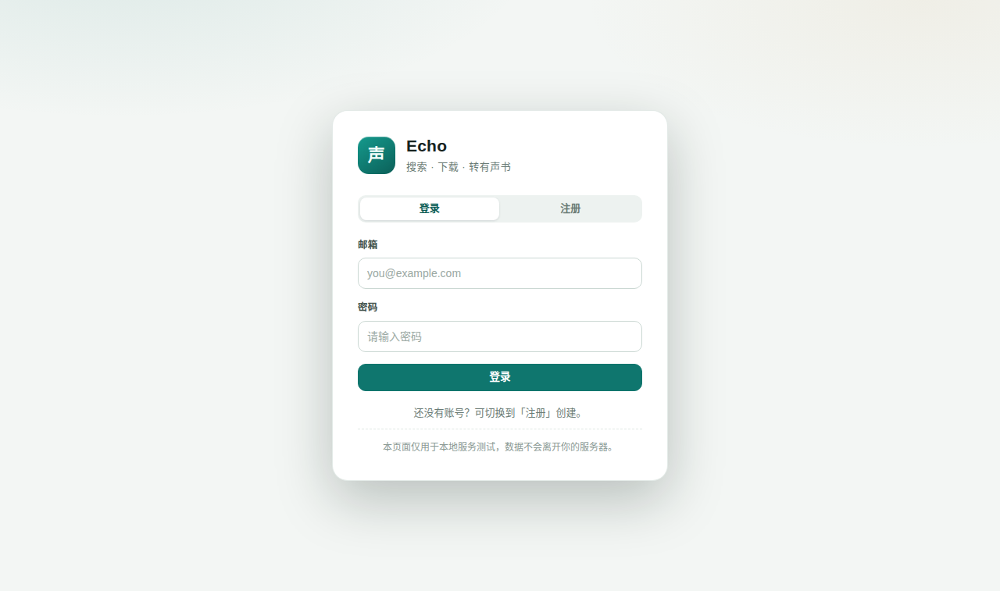
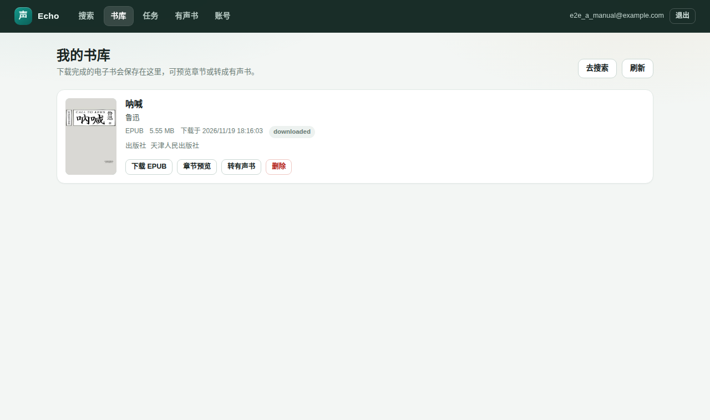
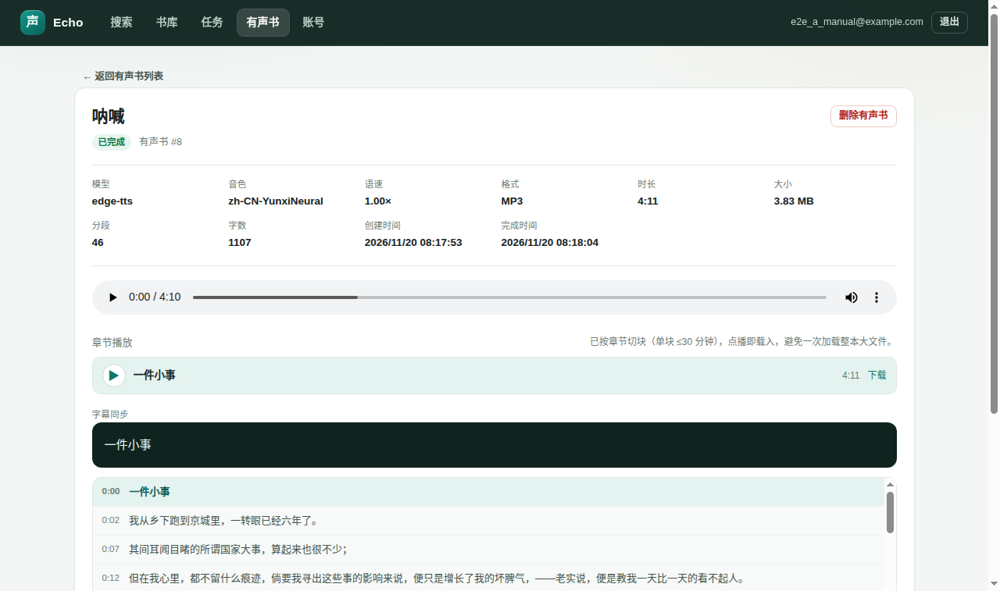

# Echo Service

**Echo App（待开发）的后端服务**：搜书、下书、转有声书、账号隔离，自带一个用于联调的 Web 前端。

- 图书源插件化：内置 zlib（纯 Go 实现 Z-Library EAPI，**不依赖 zlib 命令行**），以后可扩展其他书源。
- 有声书：调用独立的 [Echo TTS Service](https://github.com/imlinhanchao/tts-service)（本地 Qwen3-TTS / Kokoro / Edge TTS 聚合），产出**分章音频 + SRT 字幕**，支持断点续转。
- 认证：Web 用会话 Cookie，Echo App 用 **Bearer Token**（账密换取）。
- 数据：MySQL 8 + GORM，所有数据按用户隔离。



| 书库 | 章节播放 |
|---|---|
|  |  |

## 架构

```
Echo App / 测试 Web 前端
   │  HTTPS/JSON（Cookie 或 Bearer Token）
   ▼
Echo Service (Go, net/http)
   ├── auth：会话 Cookie / API Token，user_id 注入 context
   ├── providers：插件注册表 ──► zlib 插件（EAPI over HTTP）
   ├── library：书籍元数据 + 文件（按用户隔离）
   ├── jobs：下载 / 有声书任务（MySQL 持久化 + 原子领取）
   │     └── audiobook：EPUB → 分句 → TTS → 母带 → SRT → 分章
   ├── tts client ──► Echo TTS Service（HTTP）
   └── GORM ──► MySQL 8
```

## 依赖

| 依赖 | 是否必需 | 说明 |
|---|---|---|
| Go 1.27+ | 本地构建/运行必需 | 用 Docker 运行时不需要本机 Go |
| MySQL 8.0+ | **必需** | 元数据存储；首次启动会自动建库（账号需 CREATE 权限） |
| [Echo TTS Service](https://github.com/imlinhanchao/tts-service) | 转有声书时必需 | 基于 Apple Silicon MLX 的 TTS 聚合服务；不启动它仍可搜书/下书/管理书库 |
| ffmpeg | 可选（推荐） | MP3 编码与 MP3 分章；没有则输出 WAV，并用 Go 切分 WAV |
| Z-Library 账号 | 搜书/下载时必需 | 使用你自己的 zlib 账号（邮箱密码或 Cookie 导入），本服务不内置账号 |
| Node 18+ / Chrome | 可选 | 仅 `scripts/cdp_*.js` 的开发/截图脚本 |
| curl、jq | 可选 | 仅 `scripts/e2e.sh` 端到端脚本 |

> 本仓库**没有任何私有的本地依赖**：不依赖特定机器路径、不依赖 zlib CLI、不依赖本机已有数据库。
> 唯一的“外部服务”是 TTS Service（已开源）和 Z-Library（用户自己的账号）。

## 快速开始

### 方式一：Docker Compose（推荐）

```bash
git clone https://github.com/imlinhanchao/echo-service.git
cd echo-service
docker compose up -d --build
# 打开 http://127.0.0.1:8090
```

Compose 会启动 MySQL 8 和 Echo Service，并持久化 `mysql-data`、`app-data` 两个卷。
TTS 默认通过 `http://host.docker.internal:8123` 访问宿主机上的 TTS 服务（Linux 下已配置 `host-gateway`）；
如有需要可覆盖：`TTS_BASE_URL=http://192.0.2.10:8123 docker compose up -d`。

没有启动 TTS 服务时，注册、搜书、下载、书库都正常，只有“转有声书”会失败并提示 TTS 不可用。

### 方式二：本地运行

1. **准备 MySQL**（已有 MySQL 可跳过建库，应用会自动建 `echo_service` 库，账号需有 CREATE 权限）：

   ```sql
   CREATE DATABASE echo_service CHARACTER SET utf8mb4 COLLATE utf8mb4_0900_ai_ci;
   CREATE USER 'echo'@'%' IDENTIFIED BY 'change-me';
   GRANT ALL PRIVILEGES ON echo_service.* TO 'echo'@'%';
   FLUSH PRIVILEGES;
   ```

2. **配置**：

   ```bash
   cp .env.example .env
   # 编辑 .env：至少填写 ECHO_MYSQL_*；需要转有声书时设置 TTS_BASE_URL
   ```

3. **启动 TTS 服务**（可选，但转有声书需要）：

   ```bash
   git clone https://github.com/imlinhanchao/tts-service.git
   cd tts-service
   # 按该仓库 README 启动（默认 http://127.0.0.1:8123）
   ```

4. **启动 Echo Service**：

   ```bash
   go run ./cmd/echo-service
   # 浏览器打开 http://127.0.0.1:8090
   ```

## 配置项

| 变量 | 默认值 | 说明 |
|---|---|---|
| `ECHO_ADDR` | `127.0.0.1:8090` | 监听地址；局域网访问改为 `0.0.0.0:8090` |
| `ECHO_DATA_DIR` | `data` | 书库文件、音频、密钥、试听缓存 |
| `ECHO_MYSQL_HOST/PORT/USER/PASSWORD/DB` | `127.0.0.1/3306/echo/change-me/echo_service` | MySQL 连接（应用会自动建库） |
| `ECHO_SECRET` | 自动生成 | 凭据加密密钥（32 字节 base64/hex）；留空写 `data/secret.key` |
| `ECHO_ALLOW_REGISTRATION` | `1` | 是否允许注册；公网部署建议设 `0` |
| `ECHO_TOKEN_TTL` | `720h` | Echo App Bearer Token 有效期 |
| `SESSION_TTL` | `720h` | Web 会话有效期 |
| `TTS_BASE_URL` | `http://127.0.0.1:8123` | Echo TTS Service 地址 |
| `TTS_TIMEOUT` | `300s` | 单次 TTS 请求超时 |
| `FFMPEG_PATH` | 空 | ffmpeg 路径；留空从 `PATH` 查找 |
| `ZLIB_DOMAINS` | 4 个官方镜像 | zlib 候选域名 |
| `MAX_DOWNLOAD_MB` | `500` | 单本书下载大小上限 |
| `MAX_JOB_CHARS` | `500000` | 单个有声书任务字数上限 |

## 使用流程

1. 注册账号（Web 页面）；
2. 「账号」页配置 zlib：选镜像 + 邮箱密码登录，或粘贴 `remix_userid` / `remix_userkey`（Cookie 导入）；
3. 「搜索」页搜书 → 「下载到书库」；
4. 「书库」里点「转有声书」：选模型、音色、语速、章节；
5. 「任务」页看进度；完成后在「有声书」页按章节播放，字幕同步；
6. Echo App 通过 `/api/auth/token` 账密换 Token，走同一套 API。

## 认证

| 客户端 | 方式 |
|---|---|
| Web 测试前端 | `POST /api/auth/login` → `echo_session` Cookie |
| Echo App | `POST /api/auth/token` 账密换取 `echo_pat_...`，后续请求带 `Authorization: Bearer <token>` |

```bash
# 1. 账密换 Token
curl -X POST http://127.0.0.1:8090/api/auth/token \
  -H 'Content-Type: application/json' \
  -d '{"email":"you@example.com","password":"your-password","name":"iPhone"}'
# => {"token":"echo_pat_...","token_type":"Bearer","expires_at":"...","user":{...}}

# 2. 后续请求
curl -H "Authorization: Bearer $TOKEN" http://127.0.0.1:8090/api/library

# 3. 轮换 / 撤销（旧 Token 立即失效）
curl -X POST -H "Authorization: Bearer $TOKEN" http://127.0.0.1:8090/api/auth/token/refresh
curl -X POST -H "Authorization: Bearer $TOKEN" http://127.0.0.1:8090/api/auth/token/revoke
```

Token 服务端只存 SHA-256；登录有频率限制；Bearer 请求不校验 CSRF；媒体播放器拉音频时也带同一个 Authorization 头即可。

## API 概览

所有接口前缀 `/api`，JSON；错误格式 `{"error":{"code":"...","message":"..."}}`。

| 方法 | 路径 | 说明 |
|---|---|---|
| POST | `/api/auth/register` `/api/auth/login` `/api/auth/logout` | 注册 / Web 登录 / 退出 |
| POST | `/api/auth/token` `/api/auth/token/refresh` `/api/auth/token/revoke` | App 登录 / 轮换 / 撤销 Token |
| GET | `/api/auth/me` | 当前用户 |
| GET | `/api/providers` | 图书源与账号状态 |
| PUT/DELETE | `/api/providers/{id}/account` | 保存 / 删除 zlib 凭据 |
| POST | `/api/providers/{id}/account/verify` | 验证凭据并刷新配额 |
| GET | `/api/search?provider=zlib&q=&page=&limit=&ext=&lang=&year_from=&year_to=&order=` | 搜索 |
| GET | `/api/providers/{id}/books/{ref}` | 图书详情 |
| POST | `/api/library/download` | 下载入书库（异步任务） |
| GET/DELETE | `/api/library` `/api/library/{id}` | 书库 |
| GET | `/api/library/{id}/chapters` | 章节预览（`?full=1` 含正文） |
| POST | `/api/library/{id}/audiobooks` | 创建有声书转换任务 |
| GET/DELETE | `/api/audiobooks` `/api/audiobooks/{id}` | 有声书 |
| GET | `/api/audiobooks/{id}/chapters` | 分章清单（每块音频/字幕地址） |
| GET/DELETE | `/api/jobs` `/api/jobs/{id}` | 任务列表 / 详情 |
| POST | `/api/jobs/{id}/cancel` | 取消任务 |
| GET | `/api/tts/models` `/api/tts/voices` `/api/tts/sample` | TTS 模型 / 音色 / 试听 |
| GET | `/api/files/books/{id}` | 下载 EPUB |
| GET | `/api/files/audiobooks/{id}?variant=audio\|srt\|chapter&n=N\|chapter_srt&n=N` | 音频 / 字幕 / 分章文件 |

## 分章与播放

转换完成后按章节切块（单章超过 30 分钟会均分，单块 ≤30 分钟），每块独立 MP3/WAV + SRT，并生成 `manifest.json`；
整本音频不再保留（避免双份磁盘）。播放器按块加载、自动续播；App 也可以按块预下载/缓存。
已有旧数据可用 `./bin/split-audiobook -id <有声书ID>` 回填分章；`./bin/prune-full-audio -dry-run` 可检查/清理旧的整本音频。

## 任务与断点续转

- 下载与转换都是持久化任务，服务重启会把中断任务标记失败并在任务页显示原因。
- 转换中断后可用已合成的分段续转：

  ```bash
  make build
  ./bin/resume-audiobook -job <任务ID>
  ```

## 部署为常驻服务

Linux + systemd（用户级服务，开机自启，崩溃自动拉起）：

```bash
make build
make install-service
systemctl --user status echo-service
tail -f .tmp/echo-service.log
```

需要 `loginctl enable-linger $USER` 才能在注销后继续运行。

## 测试

```bash
make test          # 单元测试，不依赖 MySQL/网络
make test-mysql    # MySQL 集成测试（读 .env，自动建 echo_service_test 库）
make e2e           # 可选：真实 zlib + TTS 的端到端验收
```

`make e2e` 需要：已启动的服务、可用的 zlib 会话（`zlib login` 后的 `~/.config/zlib/session.json`，或 `ZLIB_SESSION` 指定）、可用的 TTS 服务、`curl`/`jq`；ffprobe 可选。

开发辅助脚本（可选，Node + Chrome）：`scripts/cdp_ui.js`（页面截图）、`scripts/cdp_sample.js`（音色试听）、`scripts/cdp_chapters.js`（分章播放）——在仓库根目录执行，输出到 `.tmp/ui/`。

## 目录结构

```
echo-service/
├── cmd/echo-service/          # 主服务
├── cmd/resume-audiobook/      # 断点续转
├── cmd/split-audiobook/       # 旧数据补分章
├── cmd/prune-full-audio/      # 清理整本音频
├── internal/
│   ├── api/                   # HTTP 路由与 handler
│   ├── auth/                  # 密码哈希、Token 生成
│   ├── audiobook/             # EPUB 解析、分句、TTS 流水线、母带、分章
│   ├── config/                # 环境变量
│   ├── jobs/                  # 任务队列
│   ├── providers/zlib/        # zlib 插件（纯 Go EAPI）
│   ├── store/                 # GORM 模型与仓储
│   ├── tts/                   # TTS Service 客户端
│   └── web/                   # 测试前端（embed）
├── deploy/echo-service.service # systemd 模板
├── docs/screenshots/          # README 截图
├── scripts/                   # e2e、CDP 截图、安装脚本
├── Dockerfile / docker-compose.yml
└── data/                      # 运行时生成（gitignore）
```

## 安全说明

- 每个用户的数据（书库、任务、音频、zlib 凭据）严格按 `user_id` 隔离；文件下载前校验归属。
- zlib 凭据 AES-256-GCM 加密存储；API Token 只存 SHA-256；日志不记录凭据/Token。
- Web 会话 Cookie 为 HttpOnly + SameSite=Lax；Bearer 请求跳过 CSRF，登录接口有频率限制。
- 默认监听 `127.0.0.1`；暴露到公网请加 HTTPS 反向代理，并设置 `ECHO_ALLOW_REGISTRATION=0`。

## 已知限制

- 只支持 EPUB 转有声书；PDF/MOBI 可下载但不转换。
- TTS Service 目前基于 Apple Silicon（MLX）；非 Mac 用户可只使用搜书/下书，或自行实现兼容的 TTS 服务。
- zlib 受镜像可用性、反爬和每日下载额度影响；支持域名切换与 Cookie 导入兜底。
- 单机部署、无消息队列；GORM AutoMigrate 只做增量变更。

## 贡献

- 提交前请运行 `make test`（可选 `make test-mysql`）。
- 如果你使用 AI 编码 agent，请先阅读 [AGENTS.md](AGENTS.md)：里面写了账号隔离、插件边界、TTS 契约、任务与数据迁移等硬性约定。

## 致谢与许可

- zlib EAPI 协议参考 [heartleo/zlib](https://github.com/heartleo/zlib)（MIT）。
- TTS 聚合服务：[imlinhanchao/tts-service](https://github.com/imlinhanchao/tts-service)。
- 本项目以 [MIT License](LICENSE) 开源。
